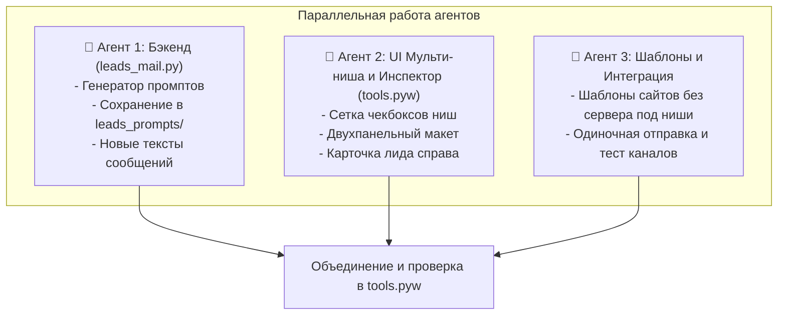

# 4 шага реализации: Парсер лидов + Сайт без сервера + Отправка с подтверждением

Версионирование и откат выполняются стандартно через Git / GitHub прямо в приложении `tools.pyw`.

---

## ⚡ Мульти-агентное ускорение (Parallel Subagents)

Задачи разделены по зонам ответственности, чтобы их можно было выполнять параллельно несколькими агентами без конфликтов:



---

## ШАГ 1: Бэкенд генератора промптов и сообщений (`leads_mail.py`)
*Ответственный: Агент 1*

### Задача:
1. В `leads_mail.py` добавить функцию `generate_site_prompt(row: dict, settings: dict) -> str`:
   - Формирует промпт для внешнего AI-агента, который будет создавать сайт для GitHub Pages (чистый HTML/CSS/JS без сервера).
   - Включает жесткую инструкцию: *«Сначала проанализируй данные бизнеса, задай мне 2-4 конкретных уточняющих вопроса по недостающим деталям и жди моих ответов перед написанием кода»*.
   - Содержит данные: название, рубрику, город, адрес, телефон, мессенджеры, рейтинг и отзывы.
2. Добавить автосохранение промпта в файл: папка `leads_prompts/` -> файл `<имя_бизнеса_транслитом_или_id>.txt`.
3. Обновить генерацию сообщения клиенту (`ai_generate` / `fallback_text`):
   - Длина: 4-6 предложений.
   - Тон: вежливый на «вы», без официоза.
   - Структура: увидели бизнес без сайта -> подготовили рабочий пример на GitHub Pages -> предложение перейти посмотреть по ссылке -> открытый вопрос в конце. Без называния цен «в лоб».
4. В `DEFAULT_SETTINGS` добавить поля:
   - `github_base_url`: базовая ссылка (по умолчанию `https://username.github.io/demo/`).
   - `site_prompt_template`: редактируемый шаблон промпта.
   - Поддержка кастомного провайдера (по умолчанию OpenRouter, но с возможностью ввести любой URL и модель).

### Как проверить результат Шага 1:
Запустить тест генерации без отправки сообщений:
```powershell
python -c "import leads_mail; row={'name':'Барбершоп Борода','rubric':'Барбершоп','city':'Москва','phone':'+79991112233'}; p=leads_mail.generate_site_prompt(row, leads_mail.DEFAULT_SETTINGS); print('--- ПРОМПТ ДЛЯ САЙТА ---\n', p)"
```
*Критерий успеха:* Вывелся подробный промпт с вопросами для агента, создалась папка `leads_prompts/` с файлом.

---

## ШАГ 2: Мульти-ниша и лимит выдачи в UI (`tools.pyw`)
*Ответственный: Агент 2*

### Задача:
1. В классе `LeadsPanel` заменить одно поле «Что искать» на блок множественного выбора ниш:
   - Сетка чекбоксов популярных ниш: Барбершоп, Стоматология, Автосервис, Ремонт квартир, Салон красоты, Юрист, Фотостудия, Ветеринар, Груминг, Фитнес, Кафе/Ресторан, Доставка еды.
   - Поле для ввода своей ниши (добавляет тему к выбранным).
2. Добавить спинбокс/комбобокс «Лимит лидов»: `10`, `20`, `50`, `100` (сколько лучших отобрать по итогу).
3. Обновить функцию сбора `leads_collect`:
   - Если выбрано несколько ниш, парсер обходит каждую нишу, объединяет карточки, дедуплицирует по `id` и ограничивает итоговый результат заданным лимитом.

### Как проверить результат Шага 2:
Запустить GUI:
```powershell
python tools.pyw
```
*Критерий успеха:* Во вкладке «Лиды» видны чекбоксы тем, можно выбрать несколько штук (например, «Барбершоп» и «Автосервис»), ввести лимит 10 и нажать «Собрать лидов». В логе и таблице появятся фирмы по обеим темам.

---

## ШАГ 3: Карточка-инспектор лида справа от таблицы (`tools.pyw`)
*Ответственный: Агент 2*

### Задача:
1. Переделать компоновку вкладки «Лиды» в двухпанельный режим:
   - Слева: таблица лидов (`ttk.Treeview`).
   - Справа: карточка выбранного лида (сворачиваемая/фиксированная панель).
2. При клике по строке таблицы в карточке справа отображаются:
   - Название, ниша, адрес, рейтинг, телефон, найденные мессенджеры.
   - Поле **«Текст сообщения»** (сгенерированный текст с возможностью ручного редактирования). Кнопка «Сгенерировать ИИ».
   - Поле **«Промпт для сайта»** с кнопкой **«📋 Скопировать промпт»** (копирует в буфер Windows и сообщает путь к файлу в `leads_prompts/`).

### Как проверить результат Шага 3:
Запустить GUI:
```powershell
python tools.pyw
```
*Критерий успеха:* Выбираем любую фирму в таблице — справа мгновенно открывается карточка. Нажимаем «📋 Скопировать промпт» — промпт в буфере обмена (можно вставить через Ctrl+V в блокнот), а в папке `leads_prompts/` появился текстовый файл.

---

## ШАГ 4: Ручное подтверждение и одиночная отправка (`tools.pyw` + `leads_mail.py`)
*Ответственный: Агент 3*

### Задача:
1. В карточке лида добавить кнопки действий:
   - Выпадающий список приоритетного канала отправки (Telegram / VK / MAX / Email).
   - Кнопка **«Отправить»**: отправляет отредактированный текст сообщения ТОЛЬКО этому выбранному лиду в выбранный канал (без автоматических очередей и фоновых циклов).
   - Кнопка **«Пропустить»**: оставляет лида в покое и переключает выделение на следующую строку таблицы.
   - Кнопка **«Удалить из пула»**.
2. В окне «Настройки ИИ» добавить удобные поля:
   - `AI Provider / Base URL` (по умолчанию `https://openrouter.ai/api/v1`).
   - `Model` (текстовое поле).
   - `API Key`.
   - `GitHub Base URL` (для подстановки в сообщения).

### Как проверить результат Шага 4:
Запустить GUI:
```powershell
python tools.pyw
```
*Критерий успеха:* Кликаем лида, редактируем текст прямо в поле, нажимаем «Отправить». Сообщение уходит только ему, в логе появляется отметка об успешной отправке. Происходит переход к следующему лиду.
